 

**Full-Stack Software Engineer | Java · Spring Boot · React · React Native**

[Portfolio](https://dhanikaj.dev) · [LinkedIn](https://linkedin.com/in/dhanikaj) · [Email](mailto:dhanika.jagodaarachchi@gmail.com) · [Résumé](https://dhanikaj.dev/resume.pdf)

---

### 👋 About

Third-year Software Engineering student in Sri Lanka seeking a **internship or junior full-stack role**. I build end-to-end software products, from database design and REST APIs to React and React Native interfaces, deployment, and technical documentation.

- 🧱 Developing client-facing e-commerce platforms alongside my degree
- 🔧 Experienced with Spring Boot services, React and React Native clients, and Android development
- 🤝 Collaborative contributor with merged pull requests across team and open-source projects

### 🛠 Skills

### 🚀 Selected work

| Project                                                                                                        | What it is                                                                                   | Stack                                   |
| -------------------------------------------------------------------------------------------------------------- | -------------------------------------------------------------------------------------------- | --------------------------------------- |
| **[SkillVerse](https://github.com/DhanikaJ/SkillVerse)** + **[UI](https://github.com/DhanikaJ/skillverse-ui)** | Online learning platform: browse and buy courses, learn, plus instructor and admin reporting | Java · React · TypeScript               |
| **[MoneyLog](https://github.com/DhanikaJ/MoneyLog)**                                                           | Cross-platform personal finance and expense tracker                                          | React Native · TypeScript               |
| **[Adyapana](https://github.com/DhanikaJ/Adyapana)**                                                           | Desktop app for students, teachers, enrollment, attendance and invoicing                     | Java                                    |
| **[FightForge](https://github.com/DhanikaJ/FightForge-readme)**                                                | Android MMA training tracker, growing into a client app                                      | Android                                 |
| **[RukRekha](https://github.com/Thyagee/RukRekha)** _(team)_                                                   | Blockchain platform verifying tree planting with IoT data, NFTs and smart contracts          | Cardano · Aiken · JavaScript · Firebase |
| **[Senastar Lover](https://www.senastarlover.lk)**                                                             | Production online store built for a real client _(private repo)_                             | Full-stack                              |

### 📊 Activity

 

<picture>
  <source media="(prefers-color-scheme: dark)" srcset="https://raw.githubusercontent.com/DhanikaJ/DhanikaJ/output/snake-dark.svg">
  
</picture>

---

**Hiring for an intern or junior full-stack engineer?** [Let's talk →](mailto:dhanika.jagodaarachchi@gmail.com)

